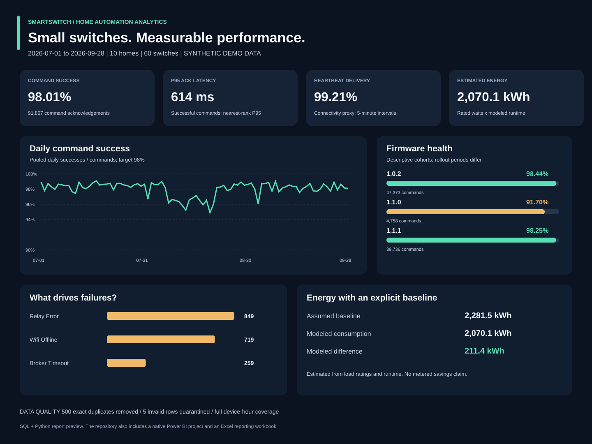

# Smart Switch Performance and Reporting Automation

### Home automation performance and reporting automation

**SQL · Python · Power BI · Excel VBA**

How reliably do smart switches respond? Which homes need connectivity fixes? What does scheduled runtime mean for estimated energy use?

This portfolio project turns synthetic smart home telemetry into a validated SQL warehouse, operational reports, a Power BI project, and an Excel reporting workflow.



**Demo scope:** 60 switches · 10 homes · 90 days · 91,867 commands · 129,600 device-hours.

All homes, switches, traffic and results are **synthetic**. The project analyzes simulated home automation events. It does not control physical switches.

## Results at a glance

| Metric | Demo result | Meaning |
|---|---:|---|
| Command success | **98.01%** | Successful device acknowledgements / valid commands |
| P95 acknowledgement latency | **614.4 ms** | Nearest-rank P95 of successful commands |
| Heartbeat delivery | **99.21%** | Received / expected heartbeats |
| Estimated consumption | **2,070.1 kWh** | Rated load × estimated on-hours |
| Modeled energy difference | **211.4 kWh** | Assumed baseline minus estimated consumption |
| Data quality handling | **500 duplicates, 5 bad rows** | Exact duplicates removed; invalid rows quarantined |

These values are calculated by the supplied pipeline. They are not real deployment results, verified electricity savings, or measured reporting time reductions.

## Why this project

Smart home teams need to distinguish an unreliable device from a Wi-Fi problem, a firmware regression, or delayed acknowledgements. A successful command alone does not explain those differences.

This project combines device reliability, connectivity, firmware and usage in one reporting workflow. Its generated scenarios include two home-level connectivity incidents, four weak-signal devices, a staged firmware regression, and a schedule change that reduces modeled runtime for selected loads.

## Start in three commands

Requires **Python 3.10 or newer**. No pip packages are needed for the core project.

```bash
python3 run.py --regenerate
python3 -m unittest discover -s tests -v
python3 scripts/check_reproducibility.py
```

On Windows, use `python` or `py -3` instead of `python3` if that is how Python is installed.

Open [the findings](reports/findings.md), [the dashboard](reports/dashboard.svg), or `excel/SmartSwitch_Reporting.xlsx`. To print the nine SQL analyses, run `python3 run.py --queries`.

The first command generates raw data, validates it, rebuilds the SQLite warehouse and exports reporting files. Run `python3 run.py` to refresh from the existing raw CSVs. A normal refresh replaces the derived outputs and warehouse.

## What each tool does

| Tool | Responsibility | Main files |
|---|---|---|
| Python | Generate repeatable data, validate, deduplicate, load, calculate P95, export reports | `src/`, `run.py` |
| SQL / SQLite | Enforce schema, join dimensions, aggregate both facts, answer operational questions | `sql/`, generated warehouse |
| Power BI | Interactive report with shared dimensions and filter-aware measures | `powerbi/SmartSwitch.pbip` |
| Excel | Formula-driven daily operations report and native chart | `excel/SmartSwitch_Reporting.xlsx` |
| VBA | Validate CSV imports, refresh report, optionally launch Python on Windows, export a PDF | `excel/SmartSwitchAutomation.bas` |
| GitHub Actions | Rebuild, run tests and check reproducibility on pushes | `.github/workflows/validate.yml` |

## Data flow and model

```text
Synthetic command and telemetry CSVs
               |
        Python validation
       /                 \
quarantine             clean data
                          |
                   SQLite warehouse
                          |
             SQL aggregates + CSV exports
                /           |          \
        Python report   Power BI     Excel + VBA
```

There are two fact grains: **one command** and **one device-hour**. Both connect to shared device and date dimensions. Power BI adds a shared firmware dimension. Facts are aggregated independently before any daily join, preventing inflated counts and energy totals.

## Explore the project

| Start here | What you will learn |
|---|---|
| [Project walkthrough](docs/PROJECT_WALKTHROUGH.md) | Problem, architecture, findings and a five-minute demo |
| [Setup and automation](docs/SETUP.md) | Run locally, schedule Python, refresh Excel |
| [Power BI guide](powerbi/README.md) | Open PBIP, set the source folder, refresh, verify and export |
| [Data dictionary](docs/DATA_DICTIONARY.md) | Tables, grains, units and KPI definitions |
| [Interview preparation](docs/INTERVIEW_PREPARATION.md) | 30 technical and scenario questions with answers |
| [Resume and portfolio wording](docs/RESUME.md) | Accurate bullets, a short introduction and link guidance |
| [GitHub publication](docs/GITHUB_UPLOAD.md) | Upload, verify the repository and make it presentable |
| [Validation record](docs/VALIDATION.md) | What was tested and what needs native application verification |

## Repository layout

```text
smartswitch-analytics/
├── config.json                 # Fixed seed, demo size and reporting thresholds
├── run.py                      # Entry point
├── src/                        # Generator, validation, ETL and report output
├── sql/                        # Schema, views and nine analyses
├── tests/                      # Business and pipeline checks
├── data/raw/                   # Source dimensions and generation manifest
├── data/processed/             # Report-ready CSVs
├── powerbi/                    # PBIP report, semantic model, M and DAX
├── excel/                      # Reporting workbook and VBA source
├── reports/                    # Dashboard, findings and quality reports
├── scripts/                    # Scheduling and reproducibility tools
└── docs/                       # Explanation, setup, resume and interview guides
```

Large generated fact CSVs and the SQLite database are excluded from Git. They are recreated by the first run. Small reporting exports and the Excel workbook are included for immediate review.

## Design decisions worth discussing

- Use pooled counts for success rates. Averaging daily percentages weights quiet and busy days equally.
- Compute P95 from command-level values. Averaging daily P95 values is mathematically incorrect.
- Keep failed-command latency null. A zero would make failed commands look fast.
- Use event-time firmware on each fact. A current device version would rewrite historical comparisons.
- Reject conflicting duplicate keys. Silently choosing a row could hide a corrupted export.
- Validate a complete device-hour grid before reporting heartbeat rates. Missing source rows must not shrink the denominator.

## Limits and next steps

Heartbeat delivery is a connectivity proxy, not exact uptime. Acknowledgement is not physical actuation confirmation. Energy uses assumed load ratings and runtime rather than a calibrated meter. Firmware comparisons are observational.

The Python pipeline and workbook formulas have been checked. Power BI Desktop refresh/rendering and VBA execution require verification in their native applications. See the [validation record](docs/VALIDATION.md). The delivered workbook is `.xlsx`; import the supplied module and save as `.xlsm` to use macros.

Possible extensions are an MQTT ingestion adapter, actual metered readings, incident grouping, versioned data retention, and device-level access controls. These extensions are not represented as completed work.

## Author

[Aradhana Singh](https://github.com/aradhanasingh3136-stack)

Licensed under [MIT](LICENSE).
